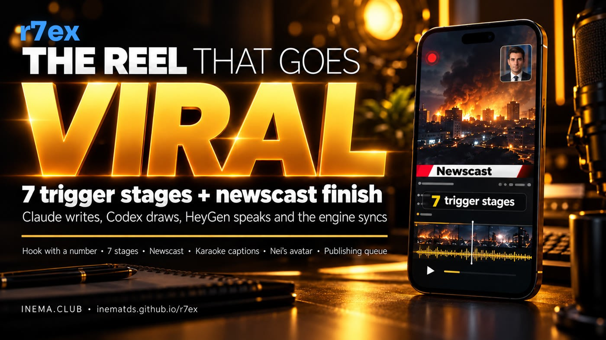

# r7ex — INEMA's viral reel

[](https://inematds.github.io/r7ex/guia/en/)

**🇧🇷 [Português](README.md) · 🇺🇸 [English](README.en.md) · 🇪🇸 [Español](README.es.md)**

## What it is

r7ex is INEMA's production line for vertical (9:16) reels. You hand it a strong idea, the thesis, and it builds a 30 to 40 second video with Nei's avatar speaking, images generated by Codex and a TV-news finish: a title in the opening, panels that come in on the right word, a counter and captions that light up along with the speech. The script follows 7 trigger stages, from a hook with a number to the request for a comment, always leading the viewer to inema.club. To use it you need Python, Node, Codex and the HeyGen subscription, running on the INEMA machine.

## 🎬 Videos about r7ex

Made with r7ex itself (10/19/2026, in Portuguese):

- [Reel 1 — "My reels got zero views, 4 batches until it worked"](https://inematds.github.io/r7ex/guia/assets/videos/r7ex-divulga.mp4)
- [Reel 2 — "The 7-step reel got old, now there is r7ex"](https://inematds.github.io/r7ex/guia/assets/videos/r7e-para-r7ex.mp4)

They also play in the guide, Examples section.

## 📖 Usage guide

Full guide (landing + step by step): **https://inematds.github.io/r7ex/guia/en/**

---

**r7ex = r7e + x.** **r7e** (reel7etapas) provides the **script**: 7 trigger stages, from the hook to the comment.
The **x** comes from **eventosextremospub**: the **TV-news finish** that goes the most viral.
The goal of every reel: **bring people to inema.club.**

This repo works **on its own**: it has its own copy of the render engine, the HeyGen studio scripts, the transcription,
the music track, the bot delivery and the publishing queue. Changing something here **does not affect** eventosextremospub, reel7etapas,
explicavideos or cardshorts.

- Fixed standard (the short rule): [`PADRAO.md`](PADRAO.md) (in Portuguese)
- Example sheet (the hacker reel): [`modelo/ficha.yaml`](modelo/ficha.yaml) (in Portuguese)

---

## 1. How we got here (10/18/2026) — 4 batches, what changed in each

| Batch | Content (what is said) | Form (what is seen) | Result |
|---|---|---|---|
| **1. old r7e** (deepseek, faxina, opencode, contexto, diga) | Topic of the day (promote a guide/repo), niche audience, hook = **promise** ("SEU AGENTE OBEDECE E GASTA MENOS" — "YOUR AGENT OBEYS AND SPENDS LESS"), 7 stages in a fixed order, weak fear that was sometimes defused right away | r7e engine: blurred stock photo behind the face on half the screen, Anton font with faded amber | No views on TikTok/Instagram |
| **2. r7e "-gatilho"** (the same 5, same avatar) | Same speech (the voice sometimes contradicted the screen) | Only the hook changed: fear/news/provocation with a number, sharp dramatic image, yellow #FACC15 with outline | Better, but "still generic" |
| **3. r7e D10** (5 theses from Nei + hacker redone; 2 on management) | **Plan before the speech** (person, what they want, hook with a number, score, destination on inema.club), **new speech** with the trigger first and the relief in the middle, fixed CTA, real screenshots of the pages | r7e engine with banner and Pillow diagrams | "Still generic" |
| **4. r7ex** (the same 7, **same avatar and speech as batch 3**) | No new content: the speech split into 7 blocks, each with an image and panel taken from the speech itself | **eventosextremospub engine**: title inside the artwork, black and gold, TV-news banner, panels timed to the speech, counter, karaoke, CTA as a question | Standard format from now on |

Lesson: the **content** got it right in batch 3 (strong theses, trigger, plan) and the **form** got it right in batch 4 (eventos engine).

### YouTube links

| What | Link |
|---|---|
| The reference one that worked (extreme event, old r7e with a caught-in-the-act shot + number) | https://www.youtube.com/shorts/DfdtX9HbkWg (lives10) |
| Batch 1 — Setup cleanup (promise, no views) | https://www.youtube.com/shorts/E5Y94BLfuJU (lives4) |
| Batch 1 — Context layer (promise, no views) | https://www.youtube.com/shorts/XflFkvIl4mw (lives4) |
| Batch 3 — Mass layoff of managers (r7e engine) | https://www.youtube.com/shorts/xpDV5qQe5oE (lives3) |
| Batch 3 — The employee who isn't a person (r7e engine) | https://www.youtube.com/shorts/cMhIavjhdh0 (lives3) |
| **Batch 4 / r7ex — Hackers stole the keys** | https://youtube.com/shorts/DG30IdeqWcg (lives7) |
| Batch 4 / r7ex — the other 6 | in the lives7 queue (1 every 2 h); `python3 fila/fila.py --status` |

## 2. How the content is built (the plan)

Before writing a single word of the speech:

1. **Person:** general audience (AI translated into everyday life), not the niche.
2. **What they want:** gain something, solve a pain or reach a desire.
3. **Hook:** fear, news or provocation, **with a number or fact** and a source.
4. **Potential score (0–10):** "would a stranger scrolling the feed stop here?" Below 7, change the angle or the topic.
5. **Destination:** the inema.club page that solves it (it becomes the proof screenshot).

Real basis: I read the course/guide page first (name, how many lessons, whether it's free). I never make up a number;
"free" only when the page says so or Nei states it.

## 3. The 7 stages — real example (the hacker reel)

| Stage | Speech | Screen |
|---|---|---|
| 1. Hook (fear) | "Hackers broke into OpenCode… US$ 1,700 in one night" | opening with the drawn title + counter 0 → 1,700 |
| 2. Fear | "The key is the password the AI uses… yours could be next" | hooded figure pulling out the key + red panel |
| 3. Desire | "Imagine sleeping knowing that… the damage has a ceiling" | man sleeping + "damage with a ceiling" |
| 4. Ease | "You don't need to be an expert, or a programmer" | limit panel + "no expert needed" |
| 5. Discovery | "It's three tweaks: a limit, one key per use, an alarm…" | padlock, keys and bell + the 3 tweaks coming in |
| 6. Benefit | "The scare turns into a notification on your phone…" | torn bill + "no limit × with limit" |
| 7. Comment | "It's all on inema.club. Or ask me for the link…" | inema.club screenshot + red CTA as a question |

The order of 2–6 adapts to the topic (e.g.: in "Who makes money in 2027" stage 3 became **proof**: "it has already happened 3 times"),
but there are always 7 parts of ~30–40 s.

## 4. What the engine does

The engine **does not create content or images**: it **syncs and animates**. It is a web page (`motor/mapa.html`) that turns into video.

- **Receives:**
  - the avatar (HeyGen) and the timing of each of its words (`r7ex/retempo.py`, local Whisper);
  - the images (Codex) and the screenshots;
  - `cena.js`, generated from the sheet by `r7ex/cena.py`: which image on which sentence, panels, counters, CTA, colors.
- **Draws in layers, frame by frame:**
  1. black background (the 3D map from the weather videos is covered);
  2. the current image, with a smooth entrance and light zoom;
  3. the top banner (brand + red badge) and the source line;
  4. the panel, with the items coming in on the second of the word and the counter going up;
  5. the karaoke captions;
  6. the CTA as a question and the inema.club pill.
- **Films** the page at 30 frames per second (`motor/render.mjs`, hidden Chrome on display `:99`).
- **Combines** (`motor/compor_avatar.sh`):
  - the face in the corner box;
  - the voice at −14 LUFS;
  - the very low music track, which ducks when you speak.

In one sentence: **Claude writes, Codex draws, HeyGen speaks and the engine syncs everything to the voice.**

## 5. What came from where

| From **r7e** (reel7etapas) | From **eventosextremospub** |
|---|---|
| The 7 trigger stages and their order | The render engine (`mapa.html`, `render.mjs`, `compor_avatar.sh`) |
| The hook = trigger with a number (D9) | The TV-news look: banner, badge, source line |
| The plan before the speech and the fixed inema.club CTA (D10) | The opening with the title drawn by Codex (`abertura-desce`) |
| Nei's avatar through the HeyGen studio | The black + yellow palette, red only for danger |
| Real page screenshots as proof | Panels with items timed to the speech and the counters |
| The queue and the delivery to bot v3 | The colored karaoke captions and the red CTA as a question |
| | `retempo` (splitting the avatar into the speech lines) |
| Also: the Whisper transcription (copy from cardshorts) | |

All of this was **copied** here (not linked): `motor/`, `heygen/`, `r7ex/whisper.py`, `r7ex/retempo.py`,
`assets/trilha.mp3`, `bin/enviar_bot_v3.mjs`, `fila/`.

## 6. How to use

```bash
cd ~/projetos/r7ex
python3 r7ex.py novo <slug>                 # creates edicoes/<data>-<slug>/ficha.yaml from the template
#   → write the plan, the opening, the 7 parts (speech + image/screenshot + panel), the CTA and "publicar"
python3 r7ex.py checar edicoes/<pasta>      # sheet gate
echo 'Nei, <data>: "<frase do OK>"' > edicoes/<pasta>/avatar/APROVADO_HEYGEN   # only with Nei's OK for this production
python3 r7ex.py fazer edicoes/<pasta>       # images + avatar → scene → render → review sheet
#   (or --de <avatar.mp4> to reuse a ready-made avatar)
# READ edicoes/<pasta>/capa/abertura.png (spelling) and edicoes/<pasta>/build/folha.jpg
python3 r7ex.py enviar edicoes/<pasta>      # bot v3
python3 r7ex.py fila edicoes/<pasta>        # end of the channel queue (default lives7)
```

Separate steps: `avatar`, `imagens`, `cena`, `render`, `revisar` (see `python3 r7ex.py`).

## 7. How to change it

### Change the layout (what is seen)
| I want to change | Where |
|---|---|
| Colors, font, size and position of the banner, panel, captions, CTA | `motor/mapa.html` (CSS and layer drawing) |
| Position and size of the face, frame, name | `motor/compor_avatar.sh` (`LAYOUT=canto`: 400x453 at x 640, y 1290) |
| Where the opening slides down, the screenshot card, the screenshot glow | `r7ex/pecas.py` (`abertura`, `print_card`) |
| Image style (palette, robot, no text) | `ESTILO` in `r7ex.py` |
| Word colors in the captions | `cores:` in the sheet (per reel) |
| Music track | `assets/trilha.mp3` |

### Change the structure (how many parts, what each one has)
- The parts are the `partes:` list in the sheet. The engine accepts any number. The `checar` gate requires 7
  (default); change it there if the standard changes.
- Each part can have an `imagem` (Codex draws it) **or** a `print` (real page), and a `painel`
  (`itens`, `contador`, `borda`).
- The panel comes in on the `de:` word and each item on its own word. Choose words that exist in the speech of that part.

### Change the planning (what is said)
- `plano:` in the sheet (pessoa, quer, gancho, nota, destino) and the rules in §2.
- The fixed rules are in `PADRAO.md` (in Portuguese) and in the `inema-design` kit (D9, D10, D11). Standard change:
  first the kit (`DECISOES.md` + `HISTORICO.md`), then here.

## 8. HeyGen and publishing

- **Avatar:** HeyGen studio through the subscription (`heygen/heygen-studio.mjs`), always on the hidden display `:99`.
  Status and download through read-only API access (authorized exception). Generate only with `avatar/APROVADO_HEYGEN` for that production.
- **HeyGen session dropped** ("não está logada" — not logged in): open **only the login window** on Nei's display (`:10`); he signs in
  with Google. The session lasts ~30 days; the red warning arrives on v3 one day before (`~/projetos/wifi/heygen-aviso`).
- **Publishing:** always through the queue (`fila/fila.py`, systemd timer `fila-lives7`, 9 am to 9 pm, 1 every 2 h),
  never a direct upload. Each publication sends a notice on v3.

## License
MIT.
